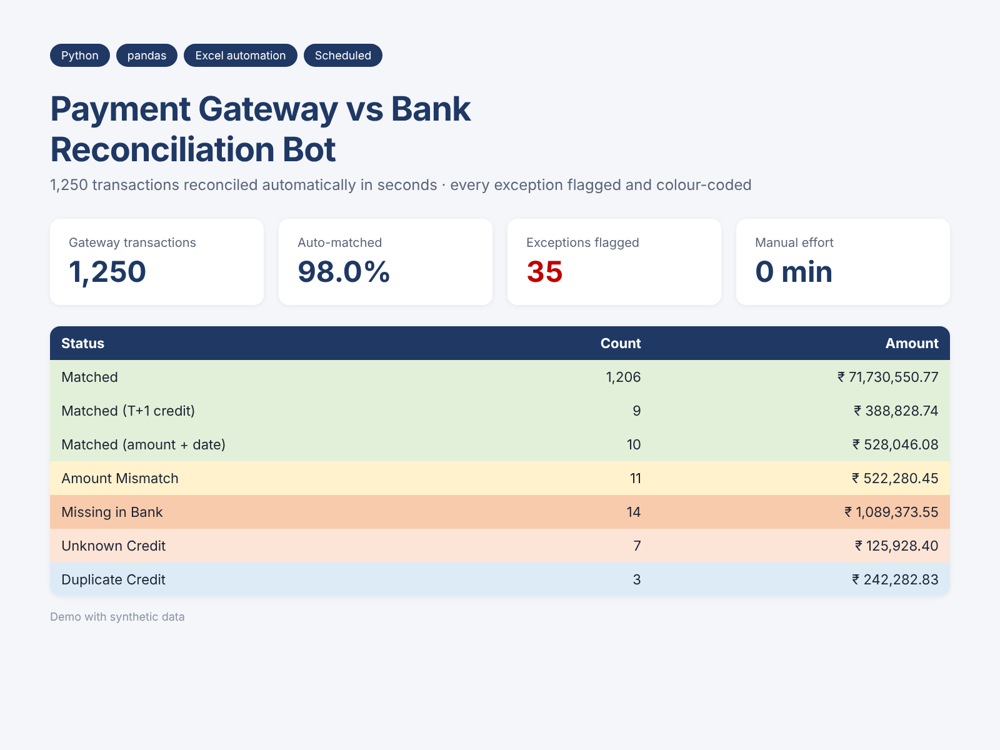

# Payment Gateway vs Bank Reconciliation — with FastAPI + RAG Analyst

Automates the daily reconciliation of payment-gateway settlements against bank credits, exposes it as a REST API,
and lets finance users ask questions about the exceptions in plain English (RAG over the results + the team's runbook).



## Features
- **Reconciliation engine** (pandas): UTR extraction with regex, amount/date tolerances, T+1 credits, fallback matching when the narration has no UTR, duplicate detection
- **Colour-coded Excel report**: Summary, Exceptions, one sheet per status, All Results (filters, frozen headers)
- **Summary email** (HTML) with the Excel attached, sent via SMTP on a schedule
- **FastAPI service**: upload files, download report, query exceptions, ask questions — typed with Pydantic, Swagger docs at `/docs`
- **RAG exception analyst**: exception rows + status summaries + runbook sections → TF-IDF retriever with status/amount boosts → any OpenAI-compatible LLM (OpenAI, Azure, Groq, Ollama) answers with citations. Works offline in extractive mode when no API key is set
- **Tests**: 11 pytest tests covering matching accuracy, Excel output, retrieval, LLM prompt wiring (mocked) and the API end to end
- **Docker** ready

## What it catches

| Status | Meaning |
|---|---|
| Matched | UTR and amount agree |
| Matched (T+1 credit) | Agrees, but the bank credited a day late |
| Matched (amount + date) | No UTR in narration; matched on a unique amount within ±1 day |
| Amount Mismatch | Same UTR, short or excess credit |
| Missing in Bank | Gateway settled it, bank never credited it |
| Unknown Credit | Bank credit with no gateway record |
| Duplicate Credit | Same UTR and amount credited twice |

## Run on Windows (double-click)
| File | What it does |
|---|---|
| `setup.bat` | One-time: creates `.venv`, installs requirements, creates `.env` |
| `run_demo.bat` | Generates data → reconciles → asks the AI a sample question → opens the Excel report |
| `start_server.bat` | Starts the FastAPI server and opens Swagger docs at http://127.0.0.1:8000/docs |
| `ask.bat` | Chat with the AI analyst about the latest results |
| `run_tests.bat` | Runs the pytest suite |

To use a real LLM, open `.env` and set `LLM_API_KEY` (and `LLM_BASE_URL` / `LLM_MODEL` for Groq or Ollama).

## Quick start (any OS)
```bash
pip install -r requirements.txt
python generate_data.py                       # synthetic files in data/
python reconcile.py --gateway data/gateway_settlement_20260930.csv \
                    --bank data/bank_statement_20260930.csv --out output
python ai_analyst.py "Which missing in bank items are above 1 lakh and what should I do?"
pytest -q
```

## API
```bash
uvicorn api:app --reload          # http://127.0.0.1:8000/docs
curl -F gateway=@data/gateway_settlement_20260930.csv -F bank=@data/bank_statement_20260930.csv http://127.0.0.1:8000/reconcile
curl -X POST http://127.0.0.1:8000/reconcile/<job_id>/ask -H "content-type: application/json" \
     -d '{"question": "Which amount mismatches are short credits?"}'
```
| Method | Path | Purpose |
|---|---|---|
| POST | `/reconcile` | Upload gateway + bank CSV → job id, match rate, summary |
| GET | `/reconcile/{job_id}/report` | Download Excel report |
| GET | `/reconcile/{job_id}/exceptions?status=` | Exceptions as JSON |
| POST | `/reconcile/{job_id}/ask` | RAG question answering |
| GET | `/health` | Liveness |

## LLM configuration
| Env var | Example |
|---|---|
| `LLM_API_KEY` | your key (unset = offline extractive mode) |
| `LLM_MODEL` | `gpt-4o-mini`, `llama-3.1-8b-instant`, ... |
| `LLM_BASE_URL` | blank for OpenAI, or `http://localhost:11434/v1` for local Ollama (keeps financial data on-prem) |

**Why TF-IDF instead of embeddings?** Finance questions are full of exact tokens (UTRs, transaction IDs, status names, amounts).
Sparse lexical retrieval matches those precisely, needs no vector DB, and runs in milliseconds. The `Retriever` class is a single
interface, so swapping in embeddings + a vector store is a local change.

## Email
Set `SMTP_HOST`, `SMTP_PORT`, `SMTP_USER`, `SMTP_PASS`, `MAIL_TO` and `reconcile.py` sends the summary with the Excel attached.

## Scheduling
Windows Task Scheduler or cron: `0 7 * * * cd /app && python reconcile.py ...`. Or run the API in Docker:
```bash
docker build -t recon-api . && docker run -p 8000:8000 -e LLM_API_KEY=... recon-api
```

## Project structure
```
generate_data.py     synthetic gateway + bank files with injected problems
reconcile.py         matching engine, Excel writer, email
ai_analyst.py        RAG: documents, retriever, LLM generation
api.py               FastAPI service
env_loader.py        loads settings from .env
*.bat                Windows launchers
knowledge/runbook.md SOP used as RAG knowledge base
tests/               pytest suite
```

*All data in this repository is synthetic.*
